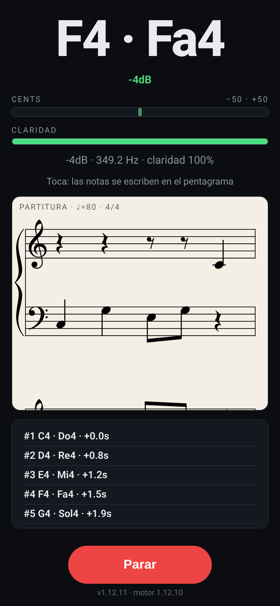

# 🎼 piano-transcribe

> Motor open source de captura y escritura musical para la web: convierte lo que tocas en el piano (micrófono, MIDI o entrada de línea) en notas y partitura, en vivo y en el dispositivo.

**[▶ Probar la demo](https://juliangdeveloper.github.io/piano-transcribe/)** · la interfaz es una demo del motor



## Usar el motor en tu proyecto
El motor es un módulo ES sin DOM publicado en `engine/v1/`. Los cambios compatibles se publican ahí; uno incompatible irá a `engine/v2/`.

```javascript
const root = 'https://juliangdeveloper.github.io/piano-transcribe/engine/v1/';
const version = (await (await fetch(root + 'version.txt', { cache: 'no-store' })).text()).trim();
const engine = await import(root + 'capture.js?v=' + version);

const session = engine.createCapture({ profile: 'score', score: { bpm: 80, timeSig: '4/4', clef: 'treble' } });
const out = session.hop(frame, sampleRate, performance.now());
```

- Llama a `hop` cada `engine.HOP_MS` (20 ms) con un `Float32Array` de un `AnalyserNode` (`fftSize` 2048). Devuelve `out.events` (notas que empiezan o terminan) y `out.score` (compases con notas y silencios).
- Con MIDI o teclado usa `session.press('C4', 'midi', now)` y `session.release('C4', 'midi', now)`.
- `profile: 'combat'` limita el rango a C3–C6; `maxVoices: 2` permite dos notas a la vez con el micrófono.
- [piano-magic](https://github.com/juliangdeveloper/piano-magic) lo usa así para su combate.

## La demo
- Pulsa **Escuchar** y en ⚙ elige micrófono, MIDI o entrada de línea.
- Arriba ves la nota, los cents y la claridad; abajo, la partitura a ♩=80 y 4/4, en clave de sol, de fa o en pentagrama doble.
- **Parar** deja la partitura; al volver a escuchar empieza de cero.

## Estado y límites
- En curso.
- Probado solo con micrófono. MIDI y entrada de línea están implementados, pero sin probar con hardware.
- La polifonía es limitada: en acordes puede aparecer una nota que no se tocó (por ejemplo, un G#3 en La menor).
- La demo usa tempo y compás fijos.

## Contribuir
El proyecto busca quien lo mejore y lo mantenga. Abre un issue o un PR, sobre todo en:
- Probar y corregir la entrada MIDI (USB y Bluetooth) y la entrada de línea.
- Polifonía y acordes más fiables.
- Exportar a MIDI y MusicXML.
- Detectar tempo y compás.

## Stack
JavaScript vanilla, Web Audio y Web MIDI; la partitura se dibuja con VexFlow. Sin dependencias de npm.

```
python3 -m http.server 8000
npm test
```

Licencia: [MIT](LICENSE). Incluye VexFlow (MIT) y la fuente Gonville (uso libre).

---

Más proyectos: https://juliangdeveloper.github.io/

Hecho con ❤️ y 🎼
